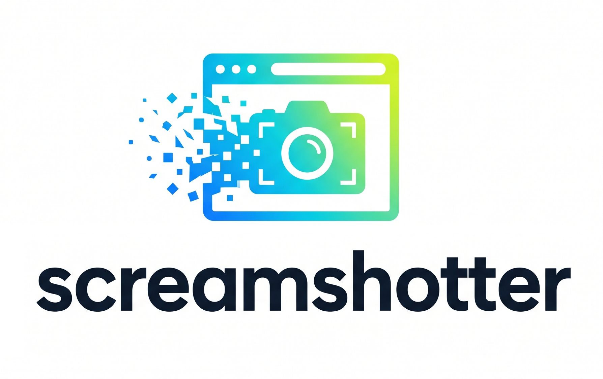

[](https://codecov.io/gh/makinacorpus/screamshotter)


<p align="center">
  
</p>

# Screamshotter

**Screamshotter** is a high-performance HTTP microservice designed to capture pixel-perfect screenshots of dynamic webpages and single-page applications (SPAs).

Built with **Django REST Framework**, **Node.js**, **Puppeteer**, and headless **Chromium**, Screamshotter handles modern web stacks seamlessly (client-side rendering, web fonts, animations, lazy loading) with built-in zombie-process reaping, request sandboxing, and customizable CSS/header injections.

---

## Table of Contents

- [Key Features](#key-features)
- [Quick Start](#quick-start)
- [API Reference](#api-reference)
  - [Endpoints](#endpoints)
  - [Parameters](#parameters)
  - [Response Formats & Content Negotiation](#response-formats--content-negotiation)
  - [Error Handling & Debugging](#error-handling--debugging)
- [Usage Examples](#usage-examples)
  - [cURL](#curl)
  - [Python](#python)
  - [JavaScript / Node.js](#javascript--nodejs)
  - [Web Test Interface](#web-test-interface)
- [Advanced Capabilities](#advanced-capabilities)
  - [Targeting DOM Elements (`selector`)](#targeting-dom-elements-selector)
  - [Single Page Apps (SPAs) & Async Loading](#single-page-apps-spas--async-loading)
  - [CSS Customization & Hiding Banners (`screamshotter_css_class`)](#css-customization--hiding-banners-screamshotter_css_class)
  - [Forwarding Authentication & Custom Headers](#forwarding-authentication--custom-headers)
  - [Remote Puppeteer / Browserless Integration](#remote-puppeteer--browserless-integration)
- [Configuration & Environment Variables](#configuration--environment-variables)
- [Installation Options](#installation-options)
  - [Docker (Recommended)](#docker-recommended)
  - [Ubuntu (.deb / APT)](#ubuntu-deb--apt)
- [Development & Testing](#development--testing)
- [License](#license)

---

## Key Features

- **Full Modern Web Support**: Renders dynamic SPAs (React, Vue, Angular, Svelte), SVG graphics, WebGL, Canvas, and web fonts.
- **Element-Level Capture**: Crop directly to any CSS selector bounding box (`selector`) or capture the full viewport.
- **Robust Synchronization**: Wait for network idle, specific DOM elements (`waitfor`, `wait_selectors`), or explicit delays (`wait_seconds`).
- **On-the-Fly CSS Injection**: Automatically adds a custom CSS class (default `screamshot`) to `<body>` to strip out cookie modals, sticky headers, or chat bubbles before shooting.
- **Flexible Content Negotiation**:
  - Raw binary image (`image/png`)
  - Base64 JSON payload (`application/json`)
  - Interactive Web UI (`text/html`) with live preview and download
- **Production Ready & Resilient**: Built-in Linux subreaper process isolation, process group cleanup, and watchdog timeouts to prevent zombie Chromium instances.
- **External Puppeteer / Browserless Support**: Offload rendering to an external browser cluster over WebSockets (`EXTERNAL_PUPPETEER`).
- **Observability**: Native integration with Sentry across both Django and Node/Puppeteer workers.

---

## Quick Start

### Run with Docker

```bash
docker run -d -p 8000:8000 --name screamshotter makinacorpus/screamshotter:latest
```

### Take your first screenshot

```bash
curl -d url=https://makina-corpus.com http://localhost:8000/ > screenshot.png
```

Open `screenshot.png` or visit `http://localhost:8000/` in your browser to use the interactive interface.

---

## API Reference

### Endpoints

| Method | Path | Description |
|---|---|---|
| `POST`, `GET` | `/` | Main screenshot capture endpoint |
| `POST`, `GET` | `/test/` | Alias endpoint to test screenshot capture |
| `GET` | `/schema/` | OpenAPI schema definition (JSON or browsable) |

> **Recommendation**: Prefer `POST` with `Content-Type: application/json` or `application/x-www-form-urlencoded` for complex payloads (e.g. `forward_headers` or multiple `wait_selectors`).

---

### Parameters

All parameters can be sent in a `POST` body (JSON or Form Data) or as `GET` query parameters.

| Parameter | Type | Required | Default | Description |
|---|---|:---:|---|---|
| `url` | `string` | **Yes** | — | Target URL to capture (e.g. `https://example.com`). Must be a valid absolute HTTP/HTTPS URL. |
| `width` | `integer` | No | `1920` | Browser viewport width in pixels. |
| `height` | `integer` | No | `1080` | Browser viewport height in pixels. |
| `selector` | `string` | No | `"body"` | CSS selector of the DOM element to clip and capture. If specified, the output image dimensions match the bounding box of this element. |
| `waitfor` | `string` | No | `"body"` | Single CSS selector to wait for before taking the screenshot. |
| `wait_selectors` | `array[string]` | No | `[]` | List of CSS selectors that must all be present in the DOM before capturing. |
| `wait_seconds` | `integer` | No | `0` | Additional pause (in seconds) after navigation and selector resolution before snapping the screenshot (useful for animations or chart rendering). |
| `screamshotter_css_class` | `string` | No | `"screamshot"` | CSS class name injected into `<body class="...">` before computing dimensions and capturing. |
| `timeout` | `integer` | No | `60` | Navigation and element wait timeout in seconds. (Overrides server-level `TIMEOUT`). |
| `forward_headers` | `object` | No | `{}` | JSON key-value map of extra HTTP headers to send with browser requests (e.g. `{"Authorization": "Bearer ...", "Cookie": "sid=..."}`). |

---

### Response Formats & Content Negotiation

Screamshotter supports three output formats depending on query parameters or standard HTTP `Accept` headers:

#### 1. Binary PNG (`image/png` — Default)
- **Requested via**: Default POST/GET request, or header `Accept: image/png`.
- **Response**: `200 OK` with binary `image/png` stream.
- **Usage**: Directly pipe to a file, an S3 upload, or an image pipeline.

#### 2. Base64 JSON (`application/json`)
- **Requested via**: `?format=json` query param, or header `Accept: application/json`.
- **Response**: `200 OK` with JSON:
  ```json
  {
    "base64": "iVBORw0KGgoAAAANSUhEUgAAB4AAAA..."
  }
  ```
- **Usage**: Ideal when calling Screamshotter from frontends, serverless lambdas, or systems where binary stream handling is inconvenient.

#### 3. Interactive Web UI (`text/html`)
- **Requested via**: Browsing to `http://localhost:8000/` or appending `?format=api`.
- **Response**: `200 OK` with HTML form, live Base64 image preview, and download action.

---

### Error Handling & Debugging

| Status Code | Reason | Example Response |
|---|---|---|
| `400 Bad Request` | Invalid input or missing mandatory fields | `{"url": ["This field is required."]}` |
| `500 Internal Server Error` | Capture failure (DNS resolution error, timeout, or missing selector) | `{"errors": "Screenshot process timed out after 80.0s"}` |

#### Debugging Missing Selectors
If a requested `selector` cannot be found on the page, Screamshotter dumps a prettified HTML view of the page in the error output:
```json
{
  "errors": "Error: Selector #non-existent-id not found\n<html>\n  <head>...</head>\n  <body>...</body>\n</html>"
}
```
This enables immediate inspection of what the headless browser actually rendered.

---

## Usage Examples

### cURL

#### Basic Capture (Raw PNG)
```bash
curl -d url=https://makina-corpus.com http://localhost:8000/ > page.png
```

#### Custom Viewport (Mobile Emulation)
```bash
curl -X POST http://localhost:8000/ \
  -H "Content-Type: application/json" \
  -d '{
    "url": "https://makina-corpus.com",
    "width": 375,
    "height": 812
  }' > mobile.png
```

#### Capture a Specific DOM Element
```bash
curl -X POST http://localhost:8000/ \
  -H "Content-Type: application/json" \
  -d '{
    "url": "https://makina-corpus.com",
    "selector": "header.site-header"
  }' > header.png
```

#### Wait for Async Data / Single Page Application
```bash
curl -X POST http://localhost:8000/ \
  -H "Content-Type: application/json" \
  -d '{
    "url": "https://example.com/analytics",
    "wait_selectors": [".chart-container", ".table-loaded"],
    "wait_seconds": 2
  }' > analytics.png
```

#### Authenticated Request with Custom Headers
```bash
curl -X POST http://localhost:8000/ \
  -H "Content-Type: application/json" \
  -d '{
    "url": "https://internal.example.com/dashboard",
    "forward_headers": {
      "Authorization": "Bearer YOUR_JWT_TOKEN",
      "X-Custom-Tenant": "tenant_123"
    }
  }' > dashboard.png
```

#### Get Base64 JSON and Decode
```bash
curl -s "http://localhost:8000/?format=json&url=https://makina-corpus.com" \
  | jq -r .base64 \
  | base64 -d > decoded.png
```

---

### Python

#### Using `requests` (Binary Stream)
```python
import requests

payload = {
    "url": "https://makina-corpus.com",
    "width": 1920,
    "height": 1080,
    "selector": "body",
    "wait_seconds": 1,
}

response = requests.post("http://localhost:8000/", json=payload, timeout=70)
response.raise_for_status()

with open("screenshot.png", "wb") as f:
    f.write(response.content)
print("Screenshot saved to screenshot.png")
```

#### Using `requests` (Base64 JSON)
```python
import base64
import requests

response = requests.post(
    "http://localhost:8000/?format=json",
    json={"url": "https://makina-corpus.com"},
    headers={"Accept": "application/json"},
)
response.raise_for_status()

b64_data = response.json()["base64"]
image_bytes = base64.b64decode(b64_data)
```

#### Using Screamshotter as an Internal Python Package
If Screamshotter is installed in your Python environment or Django project:
```python
from screenshotter.puppeteer import take_screenshot

png_bytes = take_screenshot(
    url="https://makina-corpus.com",
    width=1440,
    height=900,
    selector="#main-content",
    wait_seconds=2,
    forward_headers={"Authorization": "Bearer secret"},
)
```

---

### JavaScript / Node.js

```javascript
import fs from 'node:fs/promises';

const payload = {
  url: 'https://makina-corpus.com',
  width: 1280,
  height: 800,
  wait_selectors: ['footer'],
};

const res = await fetch('http://localhost:8000/', {
  method: 'POST',
  headers: { 'Content-Type': 'application/json' },
  body: JSON.stringify(payload),
});

if (!res.ok) {
  const err = await res.json();
  throw new Error(`Screenshot failed: ${JSON.stringify(err)}`);
}

const buffer = Buffer.from(await res.arrayBuffer());
await fs.writeFile('output.png', buffer);
console.log('Saved output.png');
```

---

### Web Test Interface

Screamshotter includes a dedicated web interface built on top of Django REST Framework. 

1. Navigate to `http://localhost:8000/` in your browser.
2. Enter the target URL and optional parameters (viewport dimensions, selectors, delays, headers).
3. Click **Submit**.
4. The page displays the captured image immediately with a convenient **Download PNG** button.

---

## Advanced Capabilities

### Targeting DOM Elements (`selector`)

Rather than capturing the whole screen or manually cropping images with PIL or ImageMagick, Screamshotter queries the exact bounding client rectangle (`getBoundingClientRect()`) of `selector`:
- `selector="body"` (default): Captures the page viewport.
- `selector="#printable-card"`: Captures strictly the card element.
- `selector=".data-visualization"`: Captures charts or tables with exact bounding coordinates.

---

### Single Page Apps (SPAs) & Async Loading

For SPAs (React, Angular, Vue, etc.) or heavy dashboards:
1. `waitfor`: Blocks until a critical root selector appears (e.g. `waitfor="#root .app-loaded"`).
2. `wait_selectors`: Pass an array of multiple selectors that must all be present simultaneously (e.g. `wait_selectors=["#map-canvas", ".legend-ready"]`).
3. `wait_seconds`: Adds an extra buffer (e.g. `2` seconds) to let CSS animations, map tiles, or WebGL shaders finish rendering after the DOM is ready.

---

### CSS Customization & Hiding Banners (`screamshotter_css_class`)

By default, Screamshotter injects the class `screamshot` into the document `<body>` element right before measurement:
```html
<body class="theme-light screamshot">
```

You can leverage this class in your site's stylesheet to hide unwanted elements specifically when Screamshotter takes a picture:

```css
/* Hide sticky navigation, cookie banners, chat widgets during screenshot */
body.screamshot header.navbar,
body.screamshot #cookie-banner,
body.screamshot #chat-widget-container,
body.screamshot .no-print {
  display: none !important;
}

/* Ensure background is white and fonts are crisp */
body.screamshot {
  background-color: #ffffff !important;
  -webkit-font-smoothing: antialiased;
}
```

You can customize this class name per request with the `screamshotter_css_class` parameter.

---

### Forwarding Authentication & Custom Headers

Use `forward_headers` to authenticate the headless browser against secured endpoints or forward session cookies:

```json
{
  "url": "https://app.example.com/reports/monthly",
  "forward_headers": {
    "Authorization": "Bearer eyJhbGciOi...",
    "Cookie": "sessionid=xyz987abc; csrftoken=123",
    "Accept-Language": "fr-FR,fr;q=0.9,en;q=0.8"
  }
}
```

---

### Remote Puppeteer / Browserless Integration

If you run Screamshotter in environments where running local Chromium is undesirable (e.g. lightweight Kubernetes pods or serverless environments), you can delegate browser execution to an external browser cluster:

Set the `EXTERNAL_PUPPETEER` environment variable to your WebSocket endpoint:
```bash
EXTERNAL_PUPPETEER=wss://chrome.browserless.io?token=YOUR_TOKEN
```
Or with docker-compose:
```yaml
services:
  web:
    image: makinacorpus/screamshotter:latest
    environment:
      - EXTERNAL_PUPPETEER=wss://your-browserless-instance:3000
```

When set, Screamshotter will call `puppeteer.connect({ browserWSEndpoint: EXTERNAL_PUPPETEER })` instead of launching a local Chromium process.

---

## Configuration & Environment Variables

| Variable | Default | Description |
|---|---|---|
| `TIMEOUT` | `60` | Global timeout (in seconds) for webpage navigation and rendering. |
| `ALLOWED_HOSTS` | `*` | Django `ALLOWED_HOSTS` setting. |
| `SECRET_KEY` | *(Random UUID)* | Django secret key. |
| `WORKERS` | `1` | Number of Gunicorn worker processes. |
| `MAX_REQUESTS` | `250` | Gunicorn maximum requests per worker before recycling (guards against memory leaks). |
| `EXTERNAL_PUPPETEER` | `""` | WebSocket endpoint (`wss://...`) to delegate Chromium tasks to a remote cluster. |
| `SCREAMSHOTTER_SENTRY_DSN` | `""` | Sentry DSN for monitoring both Django and Puppeteer errors. |
| `SCREAMSHOTTER_SENTRY_ENVIRONMENT`| `"screamshotter"` | Sentry environment name (e.g. `production`, `staging`). |
| `SCREAMSHOTTER_SENTRY_TRACE_SAMPLE`| `"0.2"` | Sentry performance traces sample rate (between `0.0` and `1.0`). |
| `COLLECTSTATIC` | `1` | Runs `collectstatic --no-input` on container startup. Set to `0` in dev mounts. |
| `NODE_BIN_PATH` | `/opt/venv/bin/node` | Path to the Node.js executable invoked by Django. |
| `PUPPETEER_CACHE_DIR` | `/opt/screamshotter/puppeteer/` | Directory where downloaded Chromium binaries reside. |

### Custom Django Settings
For package installations on Ubuntu/Debian, custom configurations can be loaded from `/opt/screamshotter/conf/custom.py`.

---

## Installation Options

### Docker (Recommended)

#### Pull and run prebuilt image
```bash
docker pull makinacorpus/screamshotter:latest
docker run -d -p 8000:8000 makinacorpus/screamshotter:latest
```

#### Run with docker-compose
```bash
git clone https://github.com/makinacorpus/screamshotter.git
cd screamshotter
docker compose up
```

---

### Ubuntu (.deb / APT)

#### From Makina Corpus APT repository
```bash
sudo apt update
sudo apt install -y wget software-properties-common
echo "deb [arch=amd64] https://packages.geotrek.fr/ubuntu $(lsb_release -sc) main" | sudo tee /etc/apt/sources.list.d/geotrek.list
wget -O- "https://packages.geotrek.fr/geotrek.gpg.key" | sudo apt-key add -
sudo apt update
sudo apt install -y screamshotter
```

Manage the service with `systemd`:
```bash
sudo systemctl status screamshotter
sudo systemctl restart screamshotter
```

Reconfigure settings at any time:
```bash
sudo dpkg-reconfigure screamshotter
```

---

## Development & Testing

### Project Architecture

```
screamshotter/
├── src/
│   ├── manage.py
│   ├── screamshotter/        # Django project config & WSGI
│   │   ├── settings/
│   │   └── templates/        # Browsable API templates with preview
│   └── screenshotter/        # Core application
│       ├── views.py          # DRF API View (ScreenshotAPIView)
│       ├── serializer.py     # Input parameters validation
│       ├── renderers.py      # Binary PNG, Base64 JSON, Browsable API
│       ├── puppeteer.py      # Subprocess runner & process management
│       └── js/index.js       # Node.js + Puppeteer script
├── Dockerfile
├── docker-compose.yml
└── Makefile
```

### Development Commands

Run quality and build checks using the provided `Makefile`:

```bash
# Update python dependencies
make deps

# Code style formatting (Ruff)
make format

# Code quality check (Ruff)
make lint

# Run all quality checks
make quality

# Build Ubuntu Debian package
make build_deb
```

---

## License

This project is licensed under the **GPL v3 License** - see the LICENSE file for details.

Maintained with ❤️ by [Makina Corpus](https://makina-corpus.com).
